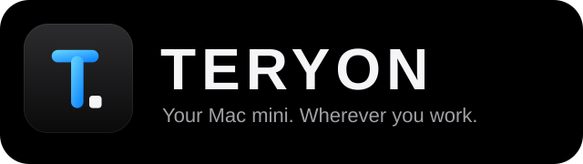
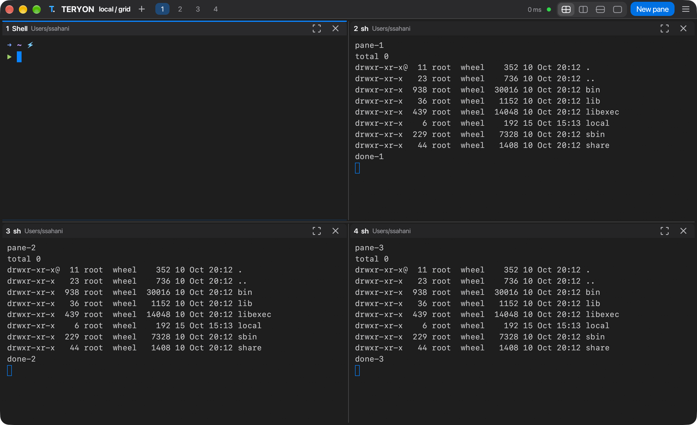

<p align="center"></p>

# TERYON

**Your Mac mini. Wherever you work.** A Rust remote workspace with persistent PTYs, a colorful terminal interface, and an optional native GPU desktop app.

TERYON separates the life of your shell from the life of your connection. A per-user service on your Mac mini or Linux host owns the terminals; OpenSSH transports the interface. Disconnect, close the client, or put your laptop to sleep, then reconnect to the same live shells.

**Status: 0.14.0 engineering preview.** This repository contains working code, integration tests, tutorials, and release automation. It is not a claim of production maturity, universal terminal compatibility, or superiority over established tools. Read [the verification report](docs/TESTING.md) and [known limits](docs/LIMITATIONS.md).

## Desktop app

One slim top bar, splits you can drag and navigate by keyboard, selection modes, scrollback, mouse reporting, a fuzzy command palette and a live-reloaded `[desktop]` config. See [docs/DESKTOP.md](docs/DESKTOP.md) for shortcuts, options and what it deliberately does not do.

## Website

A static landing page lives in `site/` and deploys to GitHub Pages through `.github/workflows/pages.yml` (set Settings → Pages → Source to "GitHub Actions" once). Preview it with `scripts/build-site.sh && open site/dist/index.html`.

## Start in one command

```bash
teryon            # pick a host and workspace (recents, config, ~/.ssh/config)
teryon setup      # guided first run: tools, SSH hosts, reachability, theme
```

## Build and try locally

Requires Rust (the repository pins 1.94.0 via rust-toolchain.toml), macOS or Linux, and a UTF-8 terminal.

```bash
cargo build --release --locked
./target/release/teryon connect local --workspace hello
```

Persistent terminals for AI agents: `claude mcp add teryon -- teryon mcp --allow-write` ([docs/MCP.md](docs/MCP.md)).

AI assistant: `export ANTHROPIC_API_KEY=…`, then `teryon ai "open Calculator"` or ⌘J in the desktop app ([docs/AI.md](docs/AI.md)).

Or use the Makefile: `make run` (desktop app), `make tui`, `make app` (macOS bundle), `make check`, `make help`.

Press **Ctrl+Space**, release, then **?** for help. **Ctrl+Space → d** detaches; your shells remain running. Open the same command again to reattach.

Build the native desktop app:

```bash
cargo build --release --features desktop --locked
./target/release/teryon desktop local --workspace hello
```

The remote machine only needs the smaller default build. Both builds speak the same protocol.




[View the Mac27 Light theme](docs/images/desktop-mac27-light.png) · [Apple Dark](docs/images/desktop-apple-dark.png) · [Apple Light](docs/images/desktop-apple-light.png). These are actual macOS application captures.

## Connect your MacBook to your Mac mini

1. On the mini, enable **System Settings → General → Sharing → Remote Login** for your user.
2. Establish SSH key authentication and verify the mini's host key using ordinary `ssh` first. TERYON requires a trusted host key and working noninteractive key/agent authentication.
3. Build on the mini and install the binary:

```bash
cargo build --release --locked
./scripts/install.sh ./target/release/teryon
```

4. On your MacBook:

```bash
teryon doctor susant@mini.local
teryon connect susant@mini.local --workspace fluxvm
# If your client was built with the desktop feature:
teryon desktop susant@mini.local --workspace fluxvm
```

Default remote executable: `$HOME/.local/bin/teryon`. Use global `--remote-bin /absolute/path` if necessary. SSH ports, identities, agents, jump hosts, VPN routing, and aliases stay in your existing OpenSSH configuration. TERYON does not bypass firewalls or NAT.

See [the complete Mac mini tutorial](docs/MAC-MINI.md), [every command](docs/CLI.md), and [deployment](docs/DEPLOYMENT.md).

## Included features

| Area | Implemented behavior |
|---|---|
| Persistent sessions | Per-user daemon owns real shells and PTYs independently of clients |
| Reconnection | Interactive clients retry with capped backoff; connection failures discard queued client actions |
| Control | One controller per workspace, multiple server-enforced read-only viewers |
| Input integrity | Ordered sequence numbers suppress duplicates within one live connection; uncertain input is never automatically replayed |
| Terminal | ANSI colors, alternate screen, Unicode cells, cursor/application modes, bracketed paste, common function/control keys, cursor/status query responses |
| Pane management | Create, focus, rename, explicitly terminate; single, vertical, horizontal and 2×2 grid layouts (up to 4 panes visible), zoom, fuzzy pane switcher, optional mouse focus |
| Native desktop | GPU canvas, pane navigation, command palette, theme chooser, font size control, copy visible screen |
| Power tools | Quick select, vi-style copy mode, snippets, broadcast input, regex find, floating panes, drag-and-drop upload, triggers |
| Shell-aware | Optional shell integration: prompt jumping, last-command output, exit-status chips, long-command notifications |
| Easy start | `teryon` picker, `teryon setup`, theme import from iTerm2/Alacritty/Ghostty/Kitty, saved layouts that come back after a reboot |
| File-type colors | New shells get `CLICOLOR`/`LS_COLORS` (only if unset), and every theme paints ANSI 0-15, so `ls` directories, executables, symlinks, archives and media look consistent |
| Terminal UI | Responsive sidebar, pane borders, status bar, help overlay, prefix shortcuts |
| Themes | Apple Dark (default, follows the netra/apple.com contract), Apple Light, Tokyo Night, Tokyo Night Storm, Catppuccin Mocha, Dracula, Gruvbox, Nord, Rosé Pine, Solarized, Obsidian, Pearl, Aurora, Ember, Ocean, Sakura, Forest, High Contrast; custom TOML palettes; WezTerm export |
| Output | Bounded 2,000-line terminal scrollback, retained-output search, private text exports |
| Offline drafts | In-memory local draft editor with explicit review and submission |
| Durable tasks | Spawn an argv-based command in a persistent pane; optionally wait and return its exit status |
| Layouts | Save initial directories/titles; restore them as new shells without replaying old commands |
| File transfers | Resumable rsync uploads/downloads with protected path arguments and no automatic deletion |
| Ports | Loopback-only OpenSSH local forwarding; optional reconnect loop |
| Deployment | SCP upload, remote executable verification, atomic same-filesystem binary replacement, remote doctor |
| Operations | `dashboard` host overview, `import-ssh` aliases, shell completions, `exec --notify` desktop notifications |
| Diagnostics | Reachability, actual daemon OS/architecture, process ID and workspace/pane counts |
| Local IPC | Private Unix socket preferred; authenticated ephemeral loopback TCP fallback in restricted environments |

## Everyday commands

```bash
teryon sessions mini
teryon panes mini --workspace fluxvm
teryon connect mini --workspace fluxvm --readonly
teryon capture mini --workspace fluxvm --pane 1 > build-output.txt
teryon exec mini --workspace builds --wait -- /usr/bin/uname -a
teryon push mini ./project/ ./project/
teryon pull mini ./results/ ./results/
teryon forward mini 3000:3000 --reconnect
teryon themes --preview
teryon dashboard
teryon import-ssh --dry-run
teryon layout save mini --workspace fluxvm ./fluxvm-layout.json
teryon layout open mini --workspace fresh-fluxvm ./fluxvm-layout.json
```

`mini` can be an OpenSSH alias, or a TERYON config alias created with `teryon init`. Edit the generated config to match your username.

## Keyboard reference

| Prefix: Ctrl+Space, then… | Action |
|---|---|
| `n` | New shell pane |
| `Tab` | Focus next pane |
| `s` | Cycle layout: single, vertical, horizontal, grid |
| `z` | Zoom / unzoom the focused pane |
| `w` | Fuzzy pane switcher |
| `x` | Close focused pane (asks to confirm) |
| `t` | Cycle the built-in themes |
| `:` | Command palette |
| `/` | Search retained output |
| `h` | Retained-output viewer (`y` copies it via OSC 52) |
| `e` | Offline draft editor |
| `?` | Help |
| `d` | Detach without killing shells |
| Ctrl+Space again | Send NUL to the remote program |

In the native desktop app, use the visible controls or **⌘K** (macOS) / **Ctrl+Shift+K** (Linux) for the command palette. **⌘D** creates a pane and **⌘F** opens output search on macOS.

## Test

```bash
cargo fmt --all --check
cargo clippy --all-targets --all-features --locked -- -D warnings
cargo test --all-targets --all-features --locked
python3 -m pip install -r tests/requirements.txt
python3 scripts/e2e.py --binary target/debug/teryon
```

The Python fixture serves SSH only during tests. Production TERYON has no Python dependency. GitHub Actions runs Rust checks on Linux/macOS and SSH integration on Linux. These workflows are provided; their hosted runs occur after you push the repository.

## Honest persistence guarantees

- A client disconnect does not intentionally terminate remote panes.
- Reconnection needs a reachable mini, a running daemon, and valid SSH authentication.
- A reboot, daemon crash, logout that terminates the service, or power failure can end live processes. Saved layouts recreate shells, not process memory.
- Offline screens are cached; they cannot establish whether remote jobs are still running.
- File transfers and forwarded HTTP/WebSocket connections have their own interruption behavior. A restored tunnel does not restore an existing TCP connection.
- Input acknowledgment means accepted into a bounded daemon queue, not executed or committed by the application.

## Documentation

- [Mac mini walkthrough](docs/MAC-MINI.md)
- [CLI and command palette](docs/CLI.md)
- [Themes and customization](docs/THEMES.md)
- [Architecture and wire protocol](docs/ARCHITECTURE.md)
- [Deployment, upgrades and packaging](docs/DEPLOYMENT.md)
- [Security model](SECURITY.md)
- [Testing and evidence](docs/TESTING.md)
- [Limitations and next milestones](docs/LIMITATIONS.md)
- [Contributing](CONTRIBUTING.md)

Apache-2.0. See [LICENSE](LICENSE).
