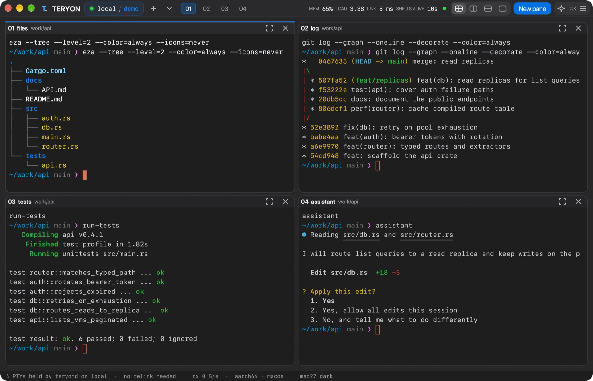
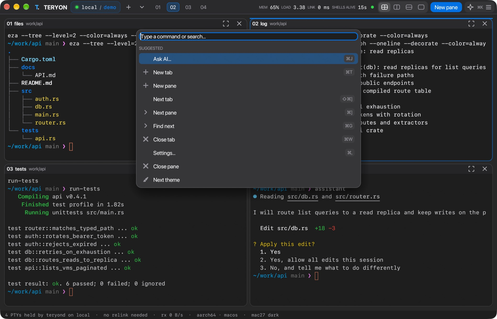
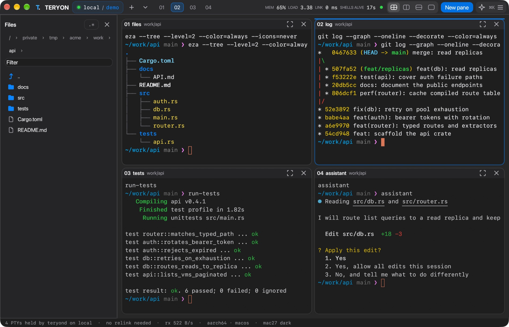

<p align="center"></p>

<p align="center">
  <a href="https://github.com/zyvorai/teryon/actions/workflows/ci.yml"></a>
  <a href="LICENSE"></a>
  <a href="https://github.com/zyvorai/teryon/releases"></a>
  <a href="https://zyvorai.github.io/teryon/"></a>
</p>

<h1 align="center">Your Mac mini.<br>Wherever you work.</h1>

<p align="center"><b>Shells that outlive your connection.</b><br>Close the lid, switch networks, come back tomorrow. Everything is exactly where you left it.</p>

<p align="center"><a href="https://zyvorai.github.io/teryon/"><b>Website</b></a> · <a href="#start-in-one-command"><b>Get started</b></a> · <a href="docs/FEATURES.md"><b>Features</b></a> · <a href="https://github.com/zyvorai/teryon/releases"><b>Releases</b></a></p>

<picture>
  <source media="(prefers-color-scheme: light)" srcset="docs/images/teryon-grid-light.jpg">
  
</picture>

> **Status: 0.20.0 engineering preview.** Working code, integration tests, tutorials and release automation. It is not a claim of production maturity, universal terminal compatibility, or superiority over established tools. Read [the verification report](docs/TESTING.md) and [known limits](docs/LIMITATIONS.md).

## Why TERYON

TERYON separates the life of your shell from the life of your connection. A per-user service on your Mac mini or Linux host owns the terminals; OpenSSH transports the interface. Disconnect, close the client, or put your laptop to sleep, then reconnect to the same live shells.

| | |
|---|---|
| **Persistent** | Real PTYs on the host. Reattach to the same shells from any client. |
| **Plain OpenSSH** | Your keys, ports, jump hosts and aliases. No new ports, no new accounts. |
| **Native desktop** | A GPU window with pane trees, a command palette and a Finder-like file browser. |
| **Built for agents** | Status chips for Claude Code, Codex, Gemini, aider, Cursor and OpenCode; Git worktrees; a sandbox; an MCP server. |
| **A link that explains itself** | When the connection drops you see the real reason and the next step. |
| **23 themes** | Apple, Mac27, Tokyo Night, Catppuccin, Dracula, Nord and more, with a WezTerm export. |

## See it

<picture>
  <source media="(prefers-color-scheme: light)" srcset="docs/images/teryon-palette-light.jpg">
  
</picture>

<sub>One slim bar, and the command palette (⌘K) for everything else.</sub>

<picture>
  <source media="(prefers-color-scheme: light)" srcset="docs/images/teryon-files-light.jpg">
  
</picture>

<sub>⌘B opens a file browser that follows <code>cd</code>, locally or over SSH. All captures are real macOS captures of a throwaway demo workspace.</sub>

## Start in one command

```bash
teryon            # pick a host and workspace (recents, config, ~/.ssh/config)
teryon setup      # guided first run: tools, SSH hosts, reachability, theme
```

## Build and try locally

Requires Rust (the repository pins 1.94.0 via rust-toolchain.toml), macOS or Linux, and a UTF-8 terminal.

```bash
cargo build --release --locked
./target/release/teryon connect local --workspace hello
```

Build the native desktop app:

```bash
cargo build --release --features desktop --locked
./target/release/teryon desktop local --workspace hello
```

The remote machine only needs the smaller default build. Both builds speak the same protocol. Press **Ctrl+Space**, release, then **?** for help. **Ctrl+Space → d** detaches; your shells remain running. Open the same command again to reattach.

## For coding agents and AI

```bash
claude mcp add teryon -- teryon mcp --allow-write      # durable panes for MCP clients
teryon sandbox -- claude                               # writes limited to this repository
export ANTHROPIC_API_KEY=…; teryon ai "open Calculator"  # or ⌘J in the desktop app
```

See [docs/MCP.md](docs/MCP.md) and [docs/AI.md](docs/AI.md). The sandbox is a guard against mistakes and leaked credentials, not a boundary against a hostile program.

## Connect your MacBook to your Mac mini

1. On the mini, enable **System Settings → General → Sharing → Remote Login** for your user.
2. Establish SSH key authentication and verify the mini's host key using ordinary `ssh` first. TERYON requires a trusted host key and working noninteractive key/agent authentication.
3. Build on the mini and install the binary:

```bash
cargo build --release --locked
./scripts/install.sh ./target/release/teryon
```

4. On your MacBook:

```bash
teryon doctor susant@mini.local
teryon connect susant@mini.local --workspace fluxvm
# If your client was built with the desktop feature:
teryon desktop susant@mini.local --workspace fluxvm
```

Default remote executable: `$HOME/.local/bin/teryon`. Use global `--remote-bin /absolute/path` if necessary. SSH ports, identities, agents, jump hosts, VPN routing, and aliases stay in your existing OpenSSH configuration. TERYON does not bypass firewalls or NAT.

See [the complete Mac mini tutorial](docs/MAC-MINI.md), [every command](docs/CLI.md), and [deployment](docs/DEPLOYMENT.md).

## Website

A static landing page lives in `site/` and deploys to GitHub Pages through `.github/workflows/pages.yml` (set Settings → Pages → Source to "GitHub Actions" once). Preview it with `scripts/build-site.sh && open site/dist/index.html`.

## Features

The full table of implemented behavior is in [docs/FEATURES.md](docs/FEATURES.md); desktop details are in [docs/DESKTOP.md](docs/DESKTOP.md).

## Everyday commands

```bash
teryon sessions mini
teryon panes mini --workspace fluxvm
teryon connect mini --workspace fluxvm --readonly
teryon capture mini --workspace fluxvm --pane 1 > build-output.txt
teryon exec mini --workspace builds --wait -- /usr/bin/uname -a
teryon push mini ./project/ ./project/
teryon pull mini ./results/ ./results/
teryon forward mini 3000:3000 --reconnect
teryon themes --preview
teryon dashboard
teryon import-ssh --dry-run
teryon layout save mini --workspace fluxvm ./fluxvm-layout.json
teryon layout open mini --workspace fresh-fluxvm ./fluxvm-layout.json
```

`mini` can be an OpenSSH alias, or a TERYON config alias created with `teryon init`. Edit the generated config to match your username.

## Keyboard reference

| Prefix: Ctrl+Space, then… | Action |
|---|---|
| `n` | New shell pane |
| `Tab` | Focus next pane |
| `s` | Cycle layout: single, vertical, horizontal, grid |
| `z` | Zoom / unzoom the focused pane |
| `w` | Fuzzy pane switcher |
| `x` | Close focused pane (asks to confirm) |
| `t` | Cycle the built-in themes |
| `:` | Command palette |
| `/` | Search retained output |
| `h` | Retained-output viewer (`y` copies it via OSC 52) |
| `e` | Offline draft editor |
| `?` | Help |
| `d` | Detach without killing shells |
| Ctrl+Space again | Send NUL to the remote program |

In the native desktop app, use the visible controls or **⌘K** (macOS) / **Ctrl+Shift+K** (Linux) for the command palette. **⌘D** creates a pane and **⌘F** opens output search on macOS.

## Test

```bash
cargo fmt --all --check
cargo clippy --all-targets --all-features --locked -- -D warnings
cargo test --all-targets --all-features --locked
python3 -m pip install -r tests/requirements.txt
python3 scripts/e2e.py --binary target/debug/teryon
```

The Python fixture serves SSH only during tests. Production TERYON has no Python dependency. GitHub Actions runs Rust checks on Linux/macOS and SSH integration on Linux. These workflows are provided; their hosted runs occur after you push the repository.

## Honest persistence guarantees

- A client disconnect does not intentionally terminate remote panes.
- Reconnection needs a reachable mini, a running daemon, and valid SSH authentication.
- A reboot, daemon crash, logout that terminates the service, or power failure can end live processes. Saved layouts recreate shells, not process memory.
- Offline screens are cached; they cannot establish whether remote jobs are still running.
- File transfers and forwarded HTTP/WebSocket connections have their own interruption behavior. A restored tunnel does not restore an existing TCP connection.
- Input acknowledgment means accepted into a bounded daemon queue, not executed or committed by the application.

## Documentation

- [Mac mini walkthrough](docs/MAC-MINI.md)
- [CLI and command palette](docs/CLI.md)
- [Themes and customization](docs/THEMES.md)
- [Architecture and wire protocol](docs/ARCHITECTURE.md)
- [Deployment, upgrades and packaging](docs/DEPLOYMENT.md)
- [Security model](SECURITY.md)
- [Testing and evidence](docs/TESTING.md)
- [Limitations and next milestones](docs/LIMITATIONS.md)
- [Contributing](CONTRIBUTING.md)

Apache-2.0. See [LICENSE](LICENSE).
