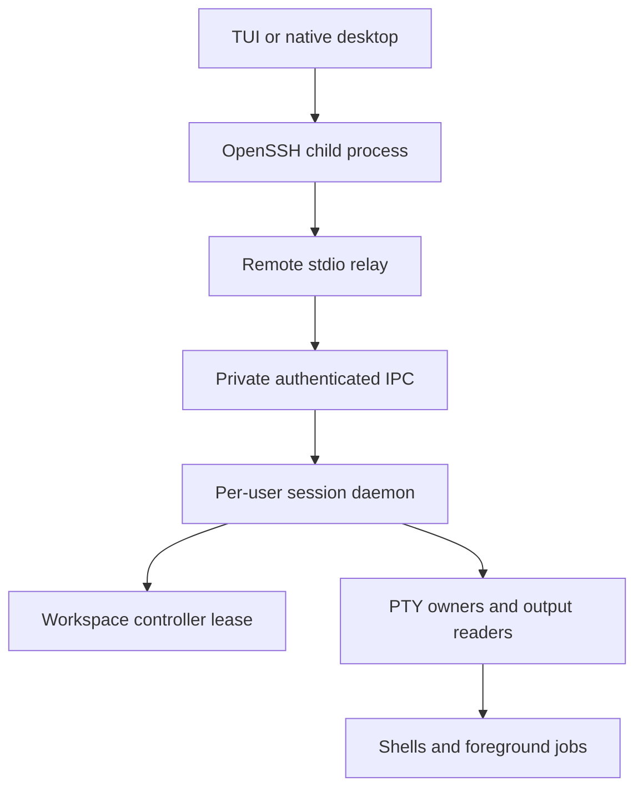

# Architecture

## Process ownership

The remote relay contains no session state. Its lifetime is tied to SSH. The daemon owns every PTY master, output reader and child wait handle; a client going away releases its controller lease but does not destroy panes.

`daemon::ensure` launches a detached process with `setsid`, null stdin, and private log output. A held file lock prevents two daemons from owning the same runtime directory. The daemon does not daemonize twice and does not install a privileged service.

## Local IPC

Default directory: `~/.teryon/run`, mode `0700`, owned by the current effective user. The endpoint descriptor is written privately with an atomic rename. The preferred transport is a mode-0600 Unix socket. If Unix socket binding is unavailable, an ephemeral `127.0.0.1` TCP listener is used. Both paths require a fresh 128-bit random token from the private descriptor before accepting protocol traffic. The token never crosses the public network: the authenticated remote relay reads it locally.

`TERYON_RUNTIME_DIR` sets an alternate private directory, useful for isolated tests. `TERYON_IPC=tcp` deliberately selects the loopback path. Do not share runtime directories across users or mount them in a public folder. TCP fallback is local authentication, not a public network service; TLS and SSH are not replaced by the bearer token.

## Wire format

Protocol version 1 uses bounded newline-delimited JSON. Binary terminal input and ANSI snapshots are JSON byte arrays. Frames are capped at 8 MiB; input actions are capped at 64 KiB. The receiver reads incrementally with a hard bound before deserializing. EOF mid-frame is an error.

First, the local IPC client sends the endpoint token as one JSON string line. Next, the application sends `{"op":"hello","version":1}`. A version mismatch is rejected before attaching a workspace. SSH itself handles network authentication, encryption and host identity.

Requests cover hello, list, attach, poll, input, resize, new pane, rename, close, capture, info, remove and shutdown. The definitions in `src/protocol.rs` are authoritative.

Poll requests include previously observed pane revisions. Changed panes return a complete formatted terminal state; unchanged panes return metadata without screen bytes. A client that sends `Poll{diff: true}` (the desktop app over SSH; older daemons ignore the flag) gets the difference from the last screen it received instead, see "Screen diffs" below. A reconnect resets the client's revision cache, so it obtains fresh full screens.

This design is not optimized for 4K video-like terminal output or very high-latency links: request/response polling adds latency and a client that asks (the desktop app over SSH) gets screen diffs instead of whole screens, and its screen bytes travel as base64 text, but other binary fields still travel as JSON number arrays, which is far larger than a binary encoding. It is a safe starting point for measuring and improving the transport.

## Screen diffs

`src/screensync.rs`. The daemon keeps, per connection, a mirror of the last screen it sent each pane. For a client that asked for diffs it sends a scroll hint (equivalent to `CSI n S`, found by best-match over the rows) plus only the changed rows, a digest (FNV over the cells the client can see) and the new cursor. The client applies it to its own copy and verifies the digest; on any mismatch, after a resize, and every 500 updates it asks for a full snapshot, so a bug here degrades to the old behavior instead of corrupting the screen. Screen bytes travel as base64 text for diff clients, and pane details (title, directory, foreground process, ports, line numbers) are sent once and then only when they change. Everything is optional on the wire (`serde` defaults and `skip_serializing_if`), so old and new clients and daemons interoperate.

Idle clients poll less often: after five seconds without input or output the worker polls every 250 ms instead of 60 ms (`quiet_poll_ms`), and input or a screen change brings the 6 ms hot interval back at once.

## Sequences the parser does not see

`vt100` is vendored with small patches (scrollback counters, OSC 8 hyperlinks stored per cell, `advance_rows` to reserve room for an image). Some sequences need more than the parser offers, so the daemon handles them around it:

- **Kitty graphics** (`src/kittygfx.rs`). The parser drops APC strings, so the reader thread first runs the bytes through an `ApcFilter` (a small state machine that survives read boundaries) which splits the stream into plain data and APC bodies. Data goes to the parser; each APC body is queued and a private OSC marker (`OSC 7777`) is fed to the parser, which calls back into `TerminalCallbacks` with the screen at exactly that point in the stream. The command is decoded there, the image is stored (raw RGB/RGBA is re-encoded as PNG), cells are reserved and the program's reply is written to its input.
- **iTerm2 inline images, marks and the directory** (`OSC 1337`, `OSC 133`, `OSC 7`) arrive through the parser's `unhandled_osc` callback. Placements are sent beside the screen and the client fetches image bytes once (`Request::Image`).
- **Kitty keyboard protocol** (`src/kittykeys.rs`): the daemon keeps a flag stack per screen and answers `CSI ? u`; the client encodes keys accordingly.

## Client-side layout

The daemon only knows a flat list of panes. Layouts (single, columns, rows, grid, and the pane tree in `src/desktop/tree.rs`) are computed in the desktop client from pane ids. The tree follows the daemon's list: a pane that disappears is removed and its neighbour takes the space, and a new pane is placed next to the focused one. The tree's shape is not saved.

## Controller leases and input

Each connection receives a random internal connection ID. A workspace permits one controller ID and any number of read-only attachments. All mutating pane operations verify the lease on the server. Disconnect releases only the matching ID, preventing an older connection from clearing a newer lease.

Input actions use consecutive sequence numbers. Repeating an already accepted number acknowledges it without writing twice. A gap is rejected. Deduplication applies to one connection and live daemon; it is not an exactly-once execution contract across reconnects, application crashes, or arbitrary shell side effects.

Acknowledgment means the input was accepted into a bounded per-pane queue. A dedicated writer thread may block on a PTY without holding the global workspace mutex. The client never automatically retries uncertain input. Client actions buffered at a connection failure are discarded throughout reconnect backoff. No zero-RTT replay of terminal commands is used.

## Terminal state

`portable-pty` creates real platform PTYs; `vt100` maintains bounded terminal state and scrollback. The server answers basic cursor-position, status, and device-attribute requests. Screen snapshots include cursor/application input modes. Output parsing happens even with no client attached, so a program cannot block merely because its client detached.

The TUI paints terminal cells with Ratatui/Crossterm; the desktop paints them with egui/eframe and an OpenGL renderer. Network operations run on a worker thread. The desktop is native Rust; there is no webview, JavaScript backend, or remote code execution in the UI.

OSC52 clipboard requests are ignored. The remote process cannot silently overwrite the local system clipboard through terminal escape sequences. Local Copy buttons perform explicit copies instead.

## Helper commands that run in a pane

Several features are deliberately small `sh` scripts typed into a pane rather than daemon features, so they work over SSH, with no client attached, and under any user shell: recipe restart policies (`restart = "on-failure"`), agent worktrees and the **Changes** listing. `teryon sandbox -- CMD` (`src/sandbox.rs`) runs a command under `sandbox-exec` (macOS) or `bwrap` (Linux) with writes limited to the Git repository and scratch and settings directories and credential directories hidden; if the tool is missing the command is not started.

## Local history

`teryon hist add` (called by the zsh integration after every command) appends to `~/.teryon/history.jsonl` (mode 0600, compacted at 4 MB) unless the command contains a secret (`src/ai/redact.rs`). `teryon hist pull HOST` copies another machine's `hist export` over SSH into `~/.teryon/history-hosts/HOST.jsonl`; those entries carry their host, appear in the picker but never in suggestions, and are secret-filtered again on import.

## State durability

PTYs, controller leases, deduplication counters, terminal screens and retained output live in daemon memory. A saved layout stores titles and the directories used when panes were created. It does not serialize process memory, shell variables, arbitrary open files or the current directory after a shell `cd`.

Restoring a layout creates new shells and never replays captured commands. Layout restoration is not transactional: an invalid later directory or a resource limit can leave a partially created new workspace, which the user can inspect and remove.
